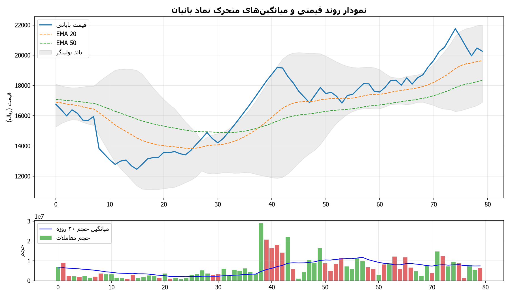
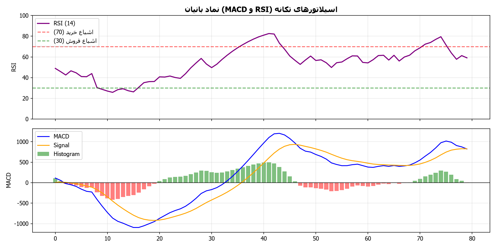
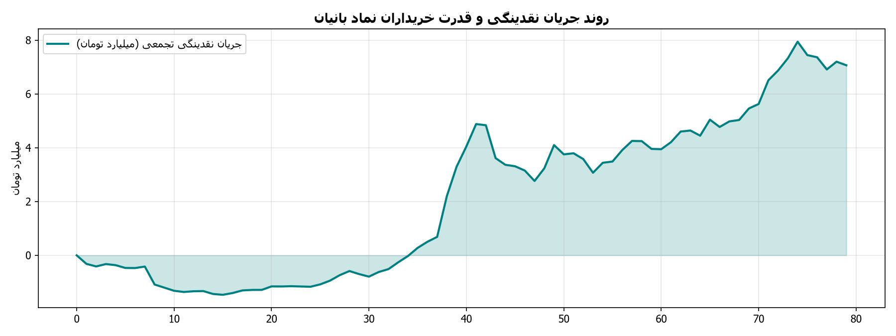

# گزارش تحلیلی جامع تکنیکال و تابلوخوانی نماد بانیان

> **📅 تاریخ و ساعت آخرین بروزرسانی:** 1405/07/28 - 16:28  
> **نویسنده و توسعه دهنده:** [tjb24.ir](https://tjb24.ir)  
**تاریخ تحلیل:** 1405/07/28 - 16:28  
**آخرین قیمت معاملاتی:** 20,180 ریال | **دامنه روز:** 19,870 تا 21,000 ریال  
**حجم معاملات آخرین روز:** 6,453,167 برگه سهم (میانگین ۲۰ روزه: 7,496,298)

---

## ۱. تحلیل ساختار روند و امواج (Trend Structure & Wave Patterns)
- **وضعیت کلی روند:** 🟢 صعودی - صعودی تثبیت‌شده (قیمت بالاتر از میانگین‌های کوتاه و میان‌مدت قرار دارد)
- **سقف ماژور دوره (Swing High):** 22,300 ریال
- **کف ماژور دوره (Swing Low):** 12,310 ریال
- **دامنه نوسان واقعی (ATR 14):** 793 ریال

### جدول میانگین‌های متحرک نمایی (Exponential Moving Averages)
| شاخص میانگین | مقدار عددی (ریال) | فاصله با قیمت فعلی | موقعیت تکنیکال |
| :--- | :--- | :--- | :--- |
| **EMA 20** | 19,646 | +2.7% | حمایت پویا |
| **EMA 50** | 18,337 | +10.1% | حمایت میان‌مدت |
| **EMA 100** | 17,510 | +15.2% | حمایت / مقاومت تراز میانی |
| **EMA 200** | 17,103 | +18.0% | مرز روند بلندمدت و استراتژیک |

### وضعیت باندهای بولینگر (Bollinger Bands)
- **باند بالایی (Upper Band):** 22,002 ریال
- **باند میانی (SMA 20):** 19,448 ریال
- **باند پایینی (Lower Band):** 16,895 ریال
- **عرض باند (Bandwidth):** 26.3% (سنجش میزان فشردگی نوسانات)

---

## ۲. تحلیل سیستم معاملاتی ایچیموکو (Ichimoku Kinko Hyo)
- **خط تنکان‌سن (Tenkan-sen 9):** 21,010 ریال
- **خط کیجون‌سن (Kijun-sen 26):** 19,575 ریال
- **ابر کومو اسپن A (Senkou Span A):** 17,148 ریال
- **ابر کومو اسپن B (Senkou Span B):** 16,035 ریال
- **ارزیابی تقاطع خطوط:** تنکان‌سن بالای کیجون‌سن (سیگنال تقاطع صعودی TK Cross)
- **موقعیت قیمت نسبت به ابر کومو:** قیمت بالای ابر کومو قرار دارد (موقعیت روند صعودی پرقدرت و حمایت ابر کومو)

---

## ۳. اسیلاتورهای تکانه و واگرایی‌ها (Momentum Oscillators & Divergences)
- **شاخص قدرت نسبی (RSI 14):** **59.1** (تکانه مثبت و برتری نسبی خریداران)
- **مکدی (MACD 12,26,9):** 822.15 | **خط سیگنال:** 827.36 | **هیستوگرام:** -5.21

### بررسی وضعیت واگرایی‌های تکنیکال (Divergence Analysis)
- **واگرایی در اسیلاتور RSI:** واگرایی واضحی در اسیلاتور RSI مشاهده نشده و تکانه همگام با نوسانات قیمت است.
- **واگرایی در اندیکاتور MACD:** تشکیل واگرایی منفی مکدی (کاهش انرژی تقاضا در قله‌های قیمتی).

---

## ۴. ترازهای فیبوناچی (Fibonacci Retracement & Expansion Levels)
مبنای محاسبه ترازهای فیبوناچی اصلاحی بر اساس آخرین موج حرکتی بین کف 12,310 و سقف 22,300 ریال:

| نسبت فیبوناچی | سطح قیمتی (ریال) | فاصله با قیمت فعلی | نقش تکنیکال |
| :--- | :--- | :--- | :--- |
| **0.0** | 22,300 | -9.5% | سقف موج (Pivot High) |
| **0.236** | 19,942 | +1.2% | حمایت / مقاومت اول اصلاحی (23.6%) |
| **0.382** | 18,484 | +9.2% | تراز اصلاحی نرمال (38.2%) |
| **0.5** | 17,305 | +16.6% | تراز میانی تعادلی (50.0%) |
| **0.618** | 16,126 | +25.1% | تراز طلایی و پرتقاضا (61.8%) |
| **0.786** | 14,448 | +39.7% | آخرین سد دفاعی روند (78.6%) |
| **1.0** | 12,310 | +63.9% | کف موج (Pivot Low) |

- **نزدیک‌ترین سطح حمایت معتبر:** **19,942 ریال**
- **نزدیک‌ترین سطح مقاومت معتبر:** **22,300 ریال**

---

## ۵. تابلوخوانی و رفتارشناسی حقیقی/حقوقی (Tape Reading & Smart Money Flow)
- **نسبت قدرت خریدار به فروشنده:** **5.81** (قدرت خریدار بسیار عالی (ورود پول هوشمند و خرید قدرتمند توسط کدهای درشت حقیقی))
- **سرانه خرید حقیقی:** 22,087 سهم | **سرانه فروش حقیقی:** 3,803 سهم
- **حجم خرید حقیقی:** 5,433,419 سهم | **حجم خرید حقوقی:** 300 سهم
- **حجم فروش حقیقی:** 3,369,634 سهم | **حجم فروش حقوقی:** 2,064,085 سهم
- **وضعیت حجم معاملات:** حجم معاملات در محدوده نرمال و نزدیک به میانگین دوره‌ای

---

## ۶. نمودارهای تحلیل تکنیکال و بصری همراه با راهنمای تحلیلی و آموزشی

### ۱. نمودار شمعی (Candlestick)، میانگین‌های متحرک نمایی و باندهای بولینگر

#### 📚 راهنمای آموزشی و تحلیل نمودار شمعی و روند:
- **کندل‌ها (شمع‌های ژاپنی):** هر کندل نوسانات قیمت در یک روز معاملاتی را نشان می‌دهد. بدنه سبز به معنی پیروزی خریداران (قیمت پایانی بالاتر از قیمت شروع) و بدنه قرمز به معنی غلبه فروشندگان است. سایه‌های بالا و پایین نیز سقف و کف قیمت روز را نشان می‌دهند.
- **میانگین‌های متحرک نمایی (EMA 20 و EMA 50):** این خطوط میانگین قیمت در ۲۰ و ۵۰ روز اخیر را به صورت هموار ترسیم می‌کنند:
  * **اگر قیمت بالای میانگین‌ها باشد:** روند سهم صعودی و پرقدرت است و خطوط میانگین مانند تکیه‌گاه و «حمایت پویا» عمل می‌کنند تا مانع از افت بیشتر قیمت شوند.
  * **اگر قیمت زیر میانگین‌ها بیاید:** نشانه ضعف روند، فشار عرضه و هشدار اصلاح قیمتی است.
- **باندهای بولینگر (Bollinger Bands):** کانالی متشکل از سقف، خط میانی و کف که دامنه طبیعی نوسان سهم را نشان می‌دهد. برخورد قیمت به سقف باند نشانه داغ شدن معاملات و هیجان خرید، و برخورد به کف باند نشانه قیمت‌های ارزان و فرصت خرید بالقوه است.
- **تحلیل وضعیت فعلی نماد:** آخرین قیمت در سطح **20,180 ریال** در مقایسه با میانگین ۲۰ روزه (19,646 ریال) و میانگین ۵۰ روزه (18,337 ریال) موقعیت **صعودی تثبیت‌شده (قیمت بالاتر از میانگین‌های کوتاه و میان‌مدت قرار دارد)** را ثبت کرده است.

---

### ۲. اسیلاتورهای تکانه و مومنتوم (RSI و MACD)

#### 📚 راهنمای آموزشی و تحلیل اسیلاتورهای تکانه (RSI و MACD):
- **شاخص قدرت نسبی (RSI):** اسیلاتوری بین ۰ تا ۱۰۰ که شتاب و هیجان معاملات را اندازه می‌گیرد:
  * **اگر RSI بالای ۷۰ باشد (اشباع خرید - Overbought):** یعنی قیمت با سرعت بسیار بالایی رشد کرده و خریداران زیادی هجوم آورده‌اند؛ در این نقطه نباید با هیجان وارد شد، چون ریسک استراحت، شناسایی سود یا اصلاح کوتاه‌مدت برای تخلیه هیجان وجود دارد.
  * **اگر RSI زیر ۳۰ باشد (اشباع فروش - Oversold):** یعنی سهم بیش از حد افت کرده و فروشندگان تخلیه شده‌اند؛ این ناحیه اغلب یک فرصت خرید جذاب با قیمت کف و نقطه بازگشت صعودی احتمالی به شمار می‌رود.
  * **محدوده بین ۳۰ تا ۷۰ (منطقه تعادل):** نوسان طبیعی سهم را نشان می‌دهد (بالای ۵۰ نشانه برتری خریداران و زیر ۵۰ نشانه برتری نسبی فروشندگان).
- **شاخص همگرایی/واگرایی میانگین متحرک (MACD):**
  * تقاطع خط آبی (MACD) به بالای خط نارنجی (Signal) و سبز شدن میله‌های هیستوگرام نشانه شروع یک موج صعودی پرشتاب است.
  * برعکس، تقاطع به سمت پایین و قرمز شدن میله‌ها علامت کاهش قدرت خریداران و شروع فاز اصلاحی است.
- **تحلیل وضعیت فعلی نماد:** مقدار فعلی RSI برابر با **59.1** (تکانه مثبت و برتری نسبی خریداران) است و هیستوگرام مکدی در وضعیت **-5.21** نوسان می‌کند.

---

### ۳. تابلوخوانی، قدرت خریدار حقیقی و جریان نقدینگی

#### 📚 راهنمای آموزشی و تحلیل جریان پول و تابلوخوانی:
- **قدرت خریدار حقیقی (Buyer Power):** این شاخص از تقسیم «میانگین خرید هر فرد حقیقی» بر «میانگین فروش هر فرد حقیقی» به دست می‌آید:
  * **اگر این نسبت بالای ۱ باشد (به‌ویژه بالای ۱.۵ یا ۲):** یعنی هر خریدار با پول درشت‌تر و سنگین‌تری (مثلا چندصد میلیون تومان) نسبت به فروشندگان خرد وارد شده است؛ این رفتار نشان‌دهنده «ورود پول هوشمند» و تمایل بازیگران بزرگ به جمع‌آوری سهم است.
  * **اگر این نسبت زیر ۱ باشد (مثلا ۰.۷):** یعنی خریداران خرد و کم‌سرمایه در حال خرید از فروشندگان درشت هستند که معمولاً نشانه خروج پول و ریسک توزیع سهم است.
- **نمودار جریان نقدینگی تجمعی (Cumulative Money Flow):** این منحنی ردپای سرمایه‌های ورودی و خروجی به سهم را نشان می‌دهد. شیب صعودی خط به معنی ورود مداوم نقدینگی و تقویت روند صعودی است، در حالی که شیب نزولی علامت خروج پول از بازار سهم است.
- **تحلیل وضعیت فعلی نماد:** نسبت قدرت خریدار به فروشنده سهم برابر با **5.81** (قدرت خریدار بسیار عالی (ورود پول هوشمند و خرید قدرتمند توسط کدهای درشت حقیقی)) با سرانه خرید **22,087 سهم** ثبت گردیده است.

---
*📅 تاریخ و ساعت آخرین بروزرسانی: 1405/07/28 - 16:28*
*نویسنده و توسعه دهنده: [tjb24.ir](https://tjb24.ir)*
*سامانه تحلیل بازار سرمایه: [tjb24.ir](https://tjb24.ir)*

## ⚠️ سلب مسئولیت حقوقی و مالی (Financial & Legal Disclaimer)

> **سلب مسئولیت (فارسی):**  
> کلیه اطلاعات، محاسبات، نمودارها، نسبت‌های مالی و ارزیابی‌های مندرج در این گزارش صرفاً با هدف تحلیل داده، آموزش و پژوهش و توسط **سامانه‌های الگوریتمی و مدل‌های هوش مصنوعی (AI)** بر مبنای اطلاعات گذشته‌نگر و آمار رسمی بازار سرمایه استخراج و تدوین گردیده‌اند. این تحلیل‌ها **به هیچ عنوان توصیه، ترغیب، مشاوره سرمایه‌گذاری یا سیگنالی برای خرید، فروش یا نگهداری هیچ‌یک از دارایی‌ها، سهام یا اوراق بهادار تلقی نمی‌شوند.** تصمیم‌گیری نهایی در خصوص هرگونه معامله در بازار بورس، مدیریت سرمایه، ارزیابی ریسک و مسئولیت کامل سود و زیان منحصراً بر عهده شخص سرمایه‌گذار است.
> 
> **Disclaimer (English):**  
> All information, calculations, charts, financial ratios, and evaluations presented in this report are generated by **algorithmic systems and Artificial Intelligence (AI) models** solely for informational, educational, and analytical purposes based on historical and public market data. **Under no circumstances should this content be considered as financial advice, investment recommendation, endorsement, or a signal to buy, sell, or hold any financial instrument or security.** Investing and trading in financial markets involve substantial risk of loss. Every investor is solely responsible for conducting independent due diligence, assessing all inherent risks, and making their own investment decisions.