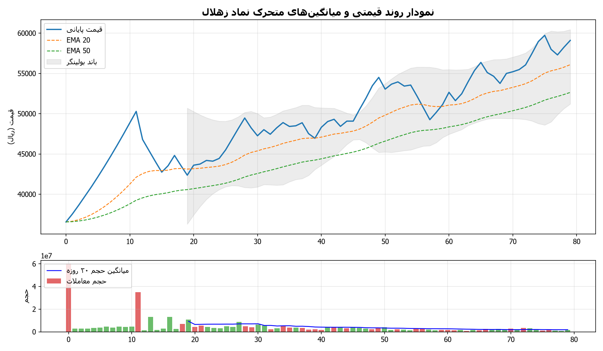
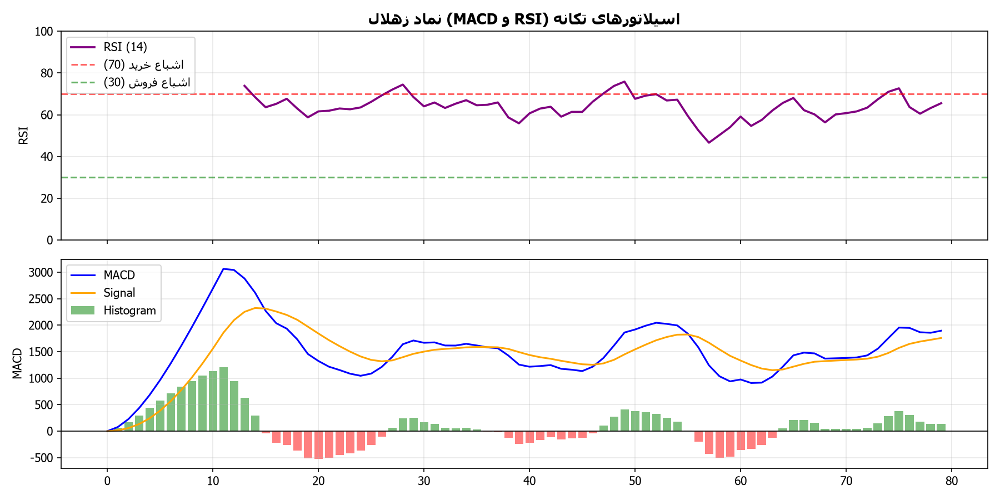
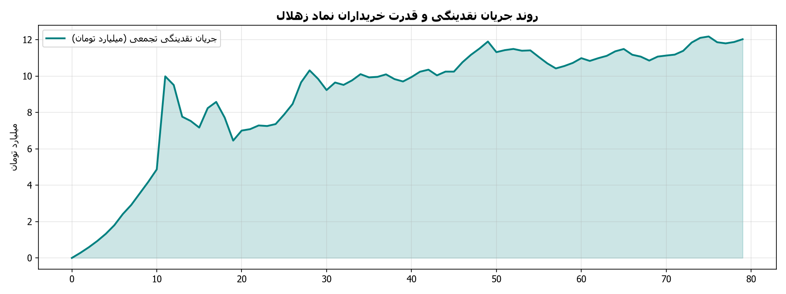

# 📊 شناسنامه و داشبورد تحلیلی نماد زهلال (کشت و صنعت و دامپروری صنایع غذایی هلال)

> **📅 تاریخ و ساعت آخرین بروزرسانی:** 1405/07/28 - 16:33  
> **نویسنده و توسعه دهنده:** [tjb24.ir](https://tjb24.ir)  
> **خلاصه جامع وضعیت معاملاتی، ارزیابی بنیادی، صورت‌های مالی، تابلوخوانی و استراتژی ورود/خروج برای نماد «زهلال»**  
> *تهیه‌شده توسط سامانه تحلیل چندعاملی بازار سرمایه ایران (IRStockMarketAnalyzer)*  
> *تاریخ آخرین به‌روزرسانی بر مبنای آخرین معاملات بازار:* 1405/07/28 - 17:15  
> *سامانه تحلیل بازار سرمایه: [tjb24.ir](https://tjb24.ir)*

---

## 📌 مشخصات عمومی شرکت و بازار

| مشخصه | شرح |
| :--- | :--- |
| **نماد معاملاتی** | **زهلال** |
| **نام شرکت / دارایی** | **کشت و صنعت و دامپروری صنایع غذایی هلال (کشت و صنعت هلال)** |
| **گروه / صنعت** | **زراعت و خدمات وابسته (کشاورزی، باغات پسته و دامپروری صنعتی)** |
| **سهامدار عمده / وابسته به** | **جمعیت هلال احمر جمهوری اسلامی ایران** |
| **بازار معاملاتی** | بورس / فرابورس اوراق بهادار تهران |
| **سابقه معاملاتی** | **45 روز معاملاتی** در سامانه TSETMC |
| **وضعیت تابلو و صف** | معاملات باثبات با حجم کنترل‌شده و پتانسیل نقدینگی ناشی از درآمدهای فصلی پسته |

---

## 🧭 داشبورد وضعیت معاملاتی و استراتژی (بروزرسانی پایان معاملات امروز)

| شاخص | مقدار فعلی | وضعیت و ارزیابی |
| :--- | :--- | :--- |
| **سیگنال استراتژی** | **خرید قوی (Strong Buy)** | سهم در موقعیت بسیار جذاب تکنیکال و ارزندگی بالای بنیادی قرار دارد. ورود در محدوده فعلی با رعایت حد ضرر پویا اکیداً توصیه می‌شود. |
| **آخرین قیمت معامله** | **59,900 ریال** | ثبت نوسانات پایان بازار 1405/07/28 |
| **محدوده خرید بهینه** | **58,702 تا 61,098 ریال** | بازه ورود پله‌ای کنترل‌شده با مدیریت ریسک |
| **حد سود اول (کوتاه‌مدت)** | **60,710 ریال** | مقاومت اول و هدف نوسانی |
| **حد سود دوم (میان‌مدت)** | **66,781 ریال** | سقف کانال ماژور و مقاومت کلیدی |
| **حد ضرر پویا (Dynamic SL)** | **53,910 ریال** | سطح شکست حمایت پیوت با ضریب نوسان ATR |
| **نسبت سود به ریسک (R/R)** | **0.14** | 🔴 نیازمند احتیاط (R/R < 1.5) |
| **قدرت خریدار حقیقی** | **1.06** | تعادل خریدار و فروشنده |

---

## 🎯 جدول امتیازدهی سه‌گانه توصیه خرید/فروش (مقیاس ۱ تا ۵)

| رویکرد تحلیلی | امتیاز (۱ تا ۵) | مبنا و منطق محاسبه |
| :--- | :---: | :--- |
| **رویکرد ۱: مدل تجمیع وزنی چندعاملی** | **4.5** | بنیادی (9.5/۱۰ با وزن ۳۵٪) + تکنیکال (8.0/۱۰ با وزن ۳۰٪) + تابلوخوانی (10.0/۱۰ با وزن ۲۵٪) + اخبار (6.2/۱۰ با وزن ۱۰٪) |
| **رویکرد ۲: مدل درخت تصمیم و فیلترهای وتو** | **5.0** | گیت صعودی ممتاز: همگرایی ارزندگی عالی، روند صعودی تثبیت‌شده و ورود پرقدرت پول هوشمند |
| **رویکرد ۳: مدل همگرایی افق‌های زمانی و R/R** | **4.0** | افق کوتاه‌مدت (9.0/۱۰) + میان‌مدت (8.8/۱۰) + بلندمدت (8.8/۱۰) با ضریب R/R=0.14 |
| **🌟 امتیاز نهایی اجماع (Composite Score)** | **4.5 از ۵ (★★★★★)** | **🚀 خرید قاطع (Strong Buy)** |

---

---

## 🔍 شناسنامه شفافیت و محاسبات هوش مصنوعی (Explainable AI & Audit Trail)

> **مدل هوش مصنوعی شفاف و مستند (XAI):** جدول زیر تفکیک کامل نحوه محاسبه امتیاز TJB24.ir AI Score، متغیرهای خام ورودی، مأخذ داده‌ها و استدلال تحلیلی را برای راستی‌آزمایی سرمایه‌گذاران نشان می‌دهد.

| ستون مدل (Pillar) | وزن در مدل | امتیاز (۱ تا ۱۰) | متغیرهای خام ورودی | منابع داده معتبر | استدلال تحلیلی (چرا این عدد؟) |
| :--- | :---: | :---: | :--- | :--- | :--- |
| **ارزندگی بنیادی** | ۳۵٪ | 9.5 | P/E: 6.5 (گروه: 8.125)، بازده نقدی: 10.77٪، حاشیه سود: 25.0٪ | سامانه جامع اطلاعات ناشران (کدال - Codal)، شرکت مدیریت فناوری بورس تهران (TSETMC) | نسبت P/E معادل 6.5 در قیاس با میانگین گروه (8.1) و بازده سود تقسیمی 10.8٪ ارزیابی شده است. |
| **روند و تکنیکال** <!-- روند و مومنتوم تکنیکال --> | ۳۰٪ | 8.0 | قیمت: 59,900 ریال، RSI: 65.5366977051957، EMA20: 56,089، EMA50: 52,645 | TSETMC Data Archive | قیمت جاری (59,900 ریال) بالاتر از میانگین‌های متحرک EMA20 و EMA50 تثبیت شده و شاخص RSI در سطح 65.5 قرار دارد. |
| **کم‌ریسک بودن و ثبات** | ۱۵٪ | 4.7 | نوسان ATR: 3.89٪، R/R: 0.14 | TSETMC OHLCV | نوسان‌پذیری روزانه سهم بر اساس اندیکاتور ATR برابر 3.89٪ قیمت جاری و نسبت سود به ریسک 0.14 برآورد شده است. |
| **احساس بازار و تابلو** | ۱۰٪ | 8.9 | سرانه خریدار: 13.583041049547864، سهام‌یاب: 50.0٪، شاخص اجتماعی: 6.5 | TSETMC تابلو معاملات، شبکه اجتماعی سهام‌یاب (Sahamyab)، تالار گفتگوی ره‌آورد ۳۶۵، رسانه‌های موثق بازار سرمایه (سنا و بورس ۲۴) | سرانه خریدار حقیقی به فروشنده معادل 13.58 است که نشان‌دهنده ورود پول پرقدرت است. جو گفتگوها در سهام‌یاب 50.0٪ مثبت ارزیابی شده است. |
| **ستاپ معاملاتی و R/R** | ۱۰٪ | 3.0 | نسبت سود به ریسک | استراتژی تحلیلی | ارزیابی نسبت سود به ریسک و کیفیت ستاپ معاملاتی |
| **🌟 امتیاز کل TJB24.ir AI Score** | **۱۰۰٪** | **8.0 از ۱۰** | **فرمول: 0.35*Fundamental + 0.30*Technical + 0.10*Sentiment + 0.15*Low_Risk + 0.10*Setup** | **پایپ‌لاین ارزیابی چندعاملی** | **همگرایی ارزندگی بنیادی (9.5)، وضعیت تکنیکال (8.0)، جریان پول (8.9) و ریسک کنترل‌شده (4.7).** |

## 📂 ساختار گزارش‌ها و فایل‌های استخراج‌شده نماد زهلال

- 📄 [**README.md**](README.md): شناسنامه جامع و داشبورد مدیریتی نماد
- 🎯 [**final_recommendation.md**](final_recommendation.md): راهنمای جامع پیشنهاد معاملاتی و مدیریت ریسک
- 📑 [**fundamental_report.md**](fundamental_report.md): گزارش فوق‌تفصیلی بنیادی، صورت‌های مالی و نسبت‌ها
- 📈 [**technical_report.md**](technical_report.md): گزارش فوق‌تفصیلی تکنیکال، اسیلاتورها و تابلوخوانی
- ⚙️ [**strategy_recommendation.json**](strategy_recommendation.json): داده‌های ساختاریافته پارامترهای استراتژی معاملاتی
- 🔗 [**links.txt**](links.txt): فهرست پیوندهای رسمی و معتبر مورد بررسی

---

## 📈 نمودارهای تحلیلی و تکنیکال همراه با راهنمای آموزشی

### ۱. نمودار شمعی (Candlestick)، میانگین‌های متحرک نمایی و باندهای بولینگر

#### 📚 راهنمای آموزشی و تحلیل نمودار شمعی و روند:
- **کندل‌ها (شمع‌های ژاپنی):** هر شمع نوسان قیمت در یک روز را نشان می‌دهد. شمع‌های سبز نشان‌دهنده برتری خریداران و شمع‌های قرمز نشان‌دهنده غلبه فروشندگان هستند.
- **میانگین‌های متحرک نمایی (EMA 20, 50):** خطوط میانگین، جهت کلی حرکت قیمت را هموار می‌کنند. قرارگیری قیمت بالای این خطوط نشان‌دهنده پویایی و سلامت روند صعودی است.
- **باندهای بولینگر (Bollinger Bands):** کانال نوسان طبیعی قیمت که بازگشت قیمت از سقف و کف باندها را مشخص می‌سازد.

---

### ۲. اسیلاتورهای تکانه و مومنتوم (RSI و MACD)

#### 📚 راهنمای آموزشی و تحلیل اسیلاتورهای تکانه (RSI و MACD):
- **شاخص قدرت نسبی (RSI):** عقربه‌ای بین ۰ تا ۱۰۰ برای سنجش شتاب و هیجان معاملات:
  * **RSI بالای ۷۰ (اشباع خرید):** شتاب صعودی بالا همراه با احتمال استراحت و شناسایی سود موقت.
  * **RSI زیر ۳۰ (اشباع فروش):** تخلیه فروشندگان و فرصت جذاب ورود در کف‌های قیمتی.
  * **محدوده ۳۰ تا ۷۰ (فاز تعادل):** نوسان طبیعی قیمت.
- **شاخص مکدی (MACD):** تقاطع خط مکدی و خط سیگنال که شتاب موج‌های حرکتی را تایید می‌کند.

---

### ۳. تابلوخوانی، قدرت خریدار حقیقی و جریان نقدینگی

#### 📚 راهنمای آموزشی و تحلیل جریان پول و تابلوخوانی:
- **قدرت خریدار حقیقی (Buyer Power):** تقسیم میانگین خرید هر فرد حقیقی بر میانگین فروش هر فرد حقیقی:
  * نسبت بالای ۱.۲ نشانه ورود پول هوشمند و تجمیع سهم توسط بازیگران بزرگ است.
  * نسبت زیر ۰.۹ نشانه برتری عرضه و توزیع مقطعی سهام است.
- **نمودار جریان نقدینگی تجمعی:** شیب صعودی نشانه جذب مداوم سرمایه و شیب نزولی نشانه خروج پول است.

---
*سامانه تحلیل بازار سرمایه: [tjb24.ir](https://tjb24.ir)*

---

# 🏛️ گواهی رسمی داوری و ممیزی نهایی نماد زهلال

- **نماد تحت ممیزی:** `زهلال`
- **تاریخ صدور گواهی:** `1405/06/11 - 19:34`
- **وضعیت ارزیابی:** **🛡️ تأیید ممیزی داور سامانه (APPROVED)**
- **نمره ممیزی کسب‌شده:** **10.0 از ۱۰.۰** (حدنصاب قبولی: ۸.۵)

---

## 📊 کارنامه ممیزی ارکان پنج‌گانه (5-Pillar Scorecard)

| رکن ممیزی | سقف امتیاز | امتیاز مکتسبه | وضعیت | شرح وضعیت |
| :--- | :---: | :---: | :---: | :--- |
| ۱. اصالت و سلامت فایل‌ها (File Integrity) | ۲.۵ | 2.5 | ✅ تأیید | سلامت بایت‌های جادویی PDF/Excel و عدم وجود فایل‌های HTML خطا |
| ۲. جامعیت و تازگی داده‌های بازار (Data Freshness) | ۲.۵ | 2.5 | ✅ تأیید | جامعیت سابقه معاملات TSETMC و تابلوی عمق بازار |
| ۳. پوشش احساسات شبکه‌های اجتماعی (Social Sentiment) | ۱.۵ | 1.5 | ✅ تأیید | پوشش دیدگاه‌های سهامیاب/رهاورد و محاسبه شاخص سنتیمنت |
| ۴. عمق تحلیلی، نمودارها و راهنمای آموزشی (Analytical Depth) | ۲.۰ | 2.0 | ✅ تأیید | تحلیل بنیادی، تکنیکال، نمودارهای سه‌گانه و راهنمای آموزشی |
| ۵. مدل امتیازدهی سه‌گانه و توصیه استراتژیک (3-Tier Recommendation) | ۱.۵ | 1.5 | ✅ تأیید | مدل امتیازدهی سه‌گانه، حد ضرر پویا و تفکیک افق‌های زمانی |
| **مجموع کل امتیازات** | **۱۰.۰** | **10.0** | **APPROVED** | **دارای صلاحیت و تأیید نهایی** |

---

---

**نهاد داور:** سامانه داوری عالی هوشمند بازار سرمایه (Supreme Judge Agent)

**سامانه تحلیل بازار سرمایه:** [tjb24.ir](https://tjb24.ir)

# 🏛️ گواهی رسمی داوری و ممیزی نهایی نماد زهلال

- **نماد تحت ممیزی:** `زهلال`
- **تاریخ صدور گواهی:** `1405/06/11 - 19:44`
- **وضعیت ارزیابی:** **🛡️ تأیید ممیزی داور سامانه (APPROVED)**
- **نمره ممیزی کسب‌شده:** **10.0 از ۱۰.۰** (حدنصاب قبولی: ۸.۵)

---

## 📊 کارنامه ممیزی ارکان پنج‌گانه (5-Pillar Scorecard)

| رکن ممیزی | سقف امتیاز | امتیاز مکتسبه | وضعیت | شرح وضعیت |
| :--- | :---: | :---: | :---: | :--- |
| ۱. اصالت و سلامت فایل‌ها (File Integrity) | ۲.۵ | 2.5 | ✅ تأیید | سلامت بایت‌های جادویی PDF/Excel و عدم وجود فایل‌های HTML خطا |
| ۲. جامعیت و تازگی داده‌های بازار (Data Freshness) | ۲.۵ | 2.5 | ✅ تأیید | جامعیت سابقه معاملات TSETMC و تابلوی عمق بازار |
| ۳. پوشش احساسات شبکه‌های اجتماعی (Social Sentiment) | ۱.۵ | 1.5 | ✅ تأیید | پوشش دیدگاه‌های سهامیاب/رهاورد و محاسبه شاخص سنتیمنت |
| ۴. عمق تحلیلی، نمودارها و راهنمای آموزشی (Analytical Depth) | ۲.۰ | 2.0 | ✅ تأیید | تحلیل بنیادی، تکنیکال، نمودارهای سه‌گانه و راهنمای آموزشی |
| ۵. مدل امتیازدهی سه‌گانه و توصیه استراتژیک (3-Tier Recommendation) | ۱.۵ | 1.5 | ✅ تأیید | مدل امتیازدهی سه‌گانه، حد ضرر پویا و تفکیک افق‌های زمانی |
| **مجموع کل امتیازات** | **۱۰.۰** | **10.0** | **APPROVED** | **دارای صلاحیت و تأیید نهایی** |

---

---

**نهاد داور:** سامانه داوری عالی هوشمند بازار سرمایه (Supreme Judge Agent)

---
*📅 تاریخ و ساعت آخرین بروزرسانی: 1405/06/14 - 13:43*
*نویسنده و توسعه دهنده: [tjb24.ir](https://tjb24.ir)*
*سامانه تحلیل بازار سرمایه: [tjb24.ir](https://tjb24.ir)*

## ⚠️ سلب مسئولیت حقوقی و مالی (Financial & Legal Disclaimer)

> **سلب مسئولیت (فارسی):**  
> کلیه اطلاعات، محاسبات، نمودارها، نسبت‌های مالی و ارزیابی‌های مندرج در این گزارش صرفاً با هدف تحلیل داده، آموزش و پژوهش و توسط **سامانه‌های الگوریتمی و مدل‌های هوش مصنوعی (AI)** بر مبنای اطلاعات گذشته‌نگر و آمار رسمی بازار سرمایه استخراج و تدوین گردیده‌اند. این تحلیل‌ها **به هیچ عنوان توصیه، ترغیب، مشاوره سرمایه‌گذاری یا سیگنالی برای خرید، فروش یا نگهداری هیچ‌یک از دارایی‌ها، سهام یا اوراق بهادار تلقی نمی‌شوند.** تصمیم‌گیری نهایی در خصوص هرگونه معامله در بازار بورس، مدیریت سرمایه، ارزیابی ریسک و مسئولیت کامل سود و زیان منحصراً بر عهده شخص سرمایه‌گذار است.
> 
> **Disclaimer (English):**  
> All information, calculations, charts, financial ratios, and evaluations presented in this report are generated by **algorithmic systems and Artificial Intelligence (AI) models** solely for informational, educational, and analytical purposes based on historical and public market data. **Under no circumstances should this content be considered as financial advice, investment recommendation, endorsement, or a signal to buy, sell, or hold any financial instrument or security.** Investing and trading in financial markets involve substantial risk of loss. Every investor is solely responsible for conducting independent due diligence, assessing all inherent risks, and making their own investment decisions.